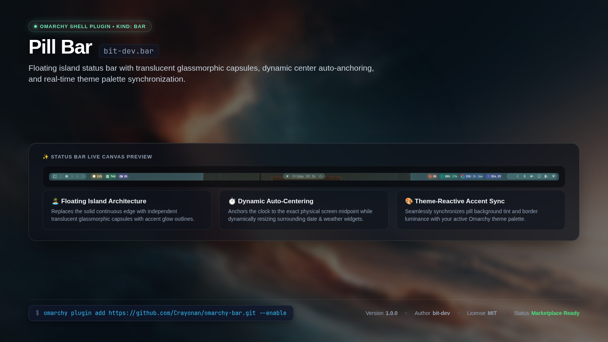

<p align="center">
  
</p>

# Pill Bar (`bit-dev.bar`)

A sleek, floating island pill-style status bar for [Omarchy](https://omarchy.org/). Replaces the full-bleed status bar with elegant translucent glassmorphic pills that dynamically adapt their width, group modules into logical islands, and seamlessly follow your active Omarchy theme accent colors.

## Features

- 🏝️ **Floating Island Architecture**: Replaces the traditional solid bar edge with independent, floating translucent pills.
- 🎨 **Theme-Reactive Accent Styling**: Automatically computes subtle pill background tints and soft glowing borders based on the active Omarchy theme accent palette (`Color.accent`).
- ⏱️ **Dynamic Auto-Centering Pill**: The center island anchors your clock module dead-center while smoothly expanding and contracting as surrounding widgets (weather, keyboard layout, updates) change size.
- 🧩 **Modular Island Groups**:
  - **Left Pill**: Clean capsule for the Omarchy launcher (`omarchy.menu`) and workspace indicators (`omarchy.workspaces`).
  - **Left System Pill**: Dedicated spot for hardware telemetry via [`bit-dev.system-pills`](https://github.com/Crayonan/omarchy-system-pills).
  - **Center Pill**: Auto-balancing island for time, date, weather, indicators, and system update alerts.
  - **Right Status Pill**: Unified capsule for hardware status toggles (Bluetooth, Audio, Brightness, Battery/Power, Network).
  - **AI Quotas Pill**: Dedicated island for provider quotas via [`bit-dev.ai-usage-pills`](https://github.com/Crayonan/omarchy-ai-usage-pills).
  - **System Tray**: Expandable drawer for background application icons.
- 🪄 **Configurable Opacity**: Easily adjust background tint opacity and border intensity directly in your `shell.json`.
- 🔄 **Non-Destructive & Easy Reversion**: Switch between Pill Bar and the stock Omarchy bar at any time with a single command.

---

## Installation

### Quick Install (Recommended)

Add and immediately activate the Pill Bar using the Omarchy CLI:

```bash
omarchy plugin add https://github.com/Crayonan/omarchy-bar.git --enable
```

### Manual Install & Enable

If you prefer to clone first and enable later:

```bash
# 1. Clone into ~/.config/omarchy/plugins/bit-dev.bar
omarchy plugin add https://github.com/Crayonan/omarchy-bar.git

# 2. Activate Pill Bar as your active status bar
omarchy plugin enable bit-dev.bar
```

---

## Companion Plugins

Pill Bar is designed to pair perfectly with these companion pill widgets:

| Plugin | Description | Install Command |
|---|---|---|
| **[System Pills](https://github.com/Crayonan/omarchy-system-pills)** (`bit-dev.system-pills`) | Live CPU, memory, and GPU usage pills | `omarchy plugin add https://github.com/Crayonan/omarchy-system-pills.git --enable` |
| **[AI Usage Pills](https://github.com/Crayonan/omarchy-ai-usage-pills)** (`bit-dev.ai-usage-pills`) | Live quota usage for Anthropic, OpenAI, Gemini & OpenRouter | `omarchy plugin add https://github.com/Crayonan/omarchy-ai-usage-pills.git --enable` |

---

## Recommended Configuration

To get the complete experience shown in the preview, update your `~/.config/omarchy/shell.json` bar section (or copy from [`example-shell.json`](example-shell.json)):

```json
{
  "version": 1,
  "bar": {
    "id": "bit-dev.bar",
    "position": "top",
    "transparent": false,
    "centerAnchor": "omarchy.clock",
    "pillOpacity": 0.24,
    "pillBorderOpacity": 0.35,
    "layout": {
      "left": [
        { "id": "omarchy.menu" },
        { "id": "omarchy.workspaces" },
        { "id": "bit-dev.system-pills" }
      ],
      "center": [
        { "id": "omarchy.indicators" },
        {
          "id": "omarchy.clock",
          "format": "dddd HH:mm",
          "formatAlt": "d MMMM 'W'ww yyyy",
          "verticalFormat": "HH\n—\nmm"
        },
        { "id": "omarchy.keyboard-layout" },
        { "id": "omarchy.weather" },
        { "id": "omarchy.system-update" }
      ],
      "right": [
        { "id": "omarchy.bluetooth" },
        { "id": "omarchy.audio" },
        { "id": "omarchy.monitor" },
        { "id": "omarchy.power" },
        { "id": "omarchy.network" },
        { "id": "bit-dev.ai-usage-pills" },
        { "id": "omarchy.tray" }
      ]
    }
  },
  "idle": {
    "screensaver": 150,
    "lock": 300
  },
  "plugins": []
}
```

The Omarchy shell automatically hot-reloads on save—no manual restart required.

---

## Customization

You can fine-tune Pill Bar settings in `~/.config/omarchy/shell.json` under the `"bar"` object:

| Key | Type | Default | Description |
|---|---|---|---|
| `id` | string | `"bit-dev.bar"` | Selects Pill Bar as the active bar implementation |
| `position` | string | `"top"` | Bar position on screen (`"top"` or `"bottom"`) |
| `pillOpacity` | number | `0.24` | Background tint opacity for pill surfaces (`0.0` to `1.0`) |
| `pillBorderOpacity` | number | `0.35` | Border stroke opacity for pill outlines (`0.0` to `1.0`) |
| `centerAnchor` | string | `"omarchy.clock"` | Widget id pinned to the exact display center |

### Gestures & Bar Controls

- **Move Bar Position**: Click and drag any empty space between pills to snap the bar to the top or bottom screen edge.
- **Reorder Widgets**: Drag widgets horizontally to rearrange their position within an island.
- **CLI Commands**:
  - Move widgets: `omarchy bar move <widget-id> --section <left|center|right>`
  - Change position: `omarchy bar position <top|bottom>`

---

## Switching Back to Stock Bar

If you ever want to revert to the default continuous Omarchy bar:

```bash
omarchy plugin enable omarchy.bar
```

Your `shell.json` widget layout is preserved.

---

## Updates

To fetch and apply the latest updates:

```bash
omarchy plugin update bit-dev.bar
```

To update all installed git-managed plugins:

```bash
omarchy plugin update --all
```

---

## Removal

To disable the bar and switch back to defaults:

```bash
omarchy plugin enable omarchy.bar
```

To completely remove the plugin files:

```bash
omarchy plugin remove bit-dev.bar
```

---

## Development & Validation

To validate the plugin structure against the official Omarchy plugin manifest schema:

```bash
omarchy plugin validate .
```

To reload plugins after making local code changes:

```bash
omarchy-shell shell rescanPlugins
```

---

## Security

This plugin runs as part of the unprivileged `omarchy-shell` process using Qt/QML. It does not run install hooks, execute shell commands on startup, or require elevated privileges.

---

## License

Licensed under the [MIT License](LICENSE).
