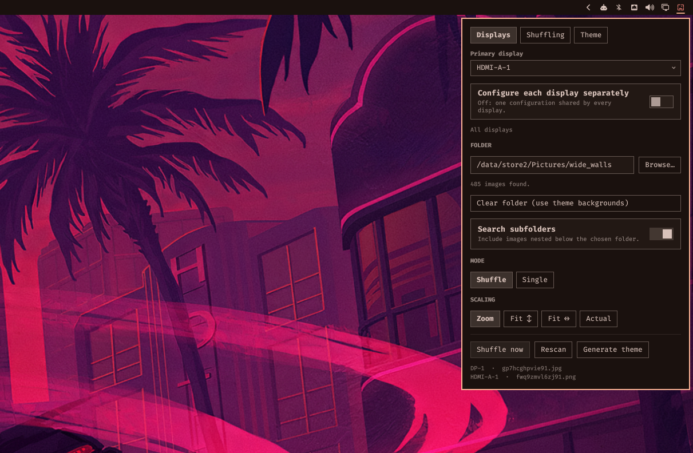

# omawall

Folder-backed wallpapers for [Omarchy](https://omarchy.org) Quattro. Every
display gets its own image, its own settings if you want them, and your whole
desktop theme can follow along.

> **Fork note (Deoxizn/omawall, v1.4.4).** Fork of
> [matjam/omawall](https://github.com/matjam/omawall), changed so Browse and
> the Single-image picker work without zenity, Nautilus, or any particular
> file manager — including on an Omarchy setup whose file manager is Strata.
> The plugin id is deliberately still `matjam.omawall`, so settings saved by
> the upstream plugin carry over instead of resetting.
>
> Fixes in this fork:
> - **Works with the 2026-11-01 shell update.** The service no longer
>   references `ScreenMoveRemap`, which Omarchy removed when Hyprland
>   0.57 started moving layer surfaces with their monitor. Before this,
>   the service failed to load and no wallpaper was drawn at all.
> - **Browse…** opens a built-in folder browser in the panel, every time.
>   No zenity, no portal, no file manager: on a system where zenity's
>   dialog is routed through Strata's portal, the old zenity-first attempt
>   just opened Strata itself with no way to select a folder.
> - **The service now sees settings wherever the widget sits.** Upstream
>   only looked in bar.layout left/center/right, so a widget in tray (or
>   centerEnd/centerBegin) was invisible to the service: the panel showed
>   the folder, the service reported "No images found in that folder".
> - **Thumbnails** in Single mode now load for `~/…` folders (the widget
>   used to pass a literal `~` to `find`) and for filenames with spaces,
>   `#`, `%` and friends (thumbnails now use a proper file URL, as the
>   hover preview already did). The grid also loads when the panel opens
>   in Single mode, and says so when it finds nothing, instead of staying
>   blank.
> - **Single actually pins.** Switching Shuffle → Single now saves the
>   image currently on screen as the pin, and there is a "Pin current
>   wallpaper" button when Single is on with no pin saved. Before, that
>   shuffle-then-single workflow saved nothing, so the next shell restart
>   dropped the image — that was the "resets every shell reset" bug.

> **Written by Claude**, Anthropic's coding agent. Tested on real hardware, but
> tested isn't proven — and Omarchy plugins run unsandboxed inside your shell
> process, with your permissions. Read the source first. No promises about
> your cat.



## Features

- **Per-display configuration** — each screen gets its own folder, mode and
  scaling, or share one configuration across all of them.
- **Shuffle or pin** — rotate a folder, or hold one image chosen from a
  thumbnail grid. Mix the two across screens.
- **Four scaling modes** — zoom, fit height, fit width, or actual size.
- **Every image before any repeat** — picks come off a shuffled queue that only
  reshuffles when it empties.
- **Shuffle** on a timer, on unlock and screensaver exit, or by hand.
- **Recursive scan** of `.jpg` `.jpeg` `.png` `.gif` `.bmp` `.webp`.
- **Skips files it can't decode** and re-deals that display.
- **Theme from wallpaper** — recolors everything Omarchy themes. Needs matugen.
- **Bar widget** for all of it. Middle-click the icon for the next image;
  hover it to see thumbnails of what each display is about to get.

With no folder set it behaves like the built-in background service, so you can
install it and decide later.

## Install

```bash
omarchy plugin add https://github.com/Deoxizn/omawall.git --enable
```

Put the widget on the `right` when prompted. This disables the built-in
`omarchy.background` — they would fight over the wallpaper — and removing
omawall restores it.

**Theme generation needs [matugen](https://github.com/InioX/matugen), which
omawall does not install for you:**

```bash
sudo pacman -S matugen    # Arch extra repo, no AUR helper needed
```

Everything else works without it, and the panel tells you when it's missing.
Add it whenever; nothing needs reinstalling.

```bash
omarchy plugin update matjam.omawall    # update (id is unchanged in this fork)
omarchy plugin remove matjam.omawall    # remove, leaves nothing behind
```

## Settings

Click the wallpaper icon in the bar. Three tabs: **Displays**, **Shuffling**,
**Theme**. Actions and what's on each screen stay visible below them.

**Displays** — per display, or shared by all of them:

| Setting | Default | Does |
| --- | --- | --- |
| Primary display | _auto_ | Whose image drives the generated theme. Marked ★ in the tabs. |
| Configure each display separately | off | On: a tab per display. Off: one shared configuration. |
| Folder | _empty_ | Where images come from. Empty = theme backgrounds. |
| Search subfolders | on | Scan recursively. |
| Mode | Shuffle | **Single** pins one image, chosen from a thumbnail grid. |
| Scaling | Zoom | Zoom, Fit ↕, Fit ↔, or Actual. |

**Shuffling** — global:

| Setting | Default | Does |
| --- | --- | --- |
| Auto-shuffle every | `0` | Seconds. `0` is off. |
| Shuffle on unlock or wake | off | Shuffle on unlock or screensaver exit instead. |
| Different image per display | on | Off mirrors one image across displays sharing a folder. |

**Theme** — global: generate from wallpaper, and light or dark. See
[Theme from wallpaper](#theme-from-wallpaper).

### Mixing displays

Set one display to **Single** and another to **Shuffle** and you get exactly
that: the pinned one never moves while the other rotates. Displays pointed at
the same folder share a pool and a deal queue, so they never show the same
image at once and still see every image before repeating; displays on
different folders rotate independently.

The four scaling modes only differ when the image and the screen disagree
about shape. A 3440×1440 wallpaper on a 3440×1440 screen looks identical under
Zoom, Fit ↕ and Actual, because it is.

### Next image

The pool is dealt from a shuffled queue that only reshuffles once it empties,
so there is always a next image waiting rather than a fresh roll of the dice.
**Next image** hands it out — to every display set to Shuffle, leaving the
pinned ones alone. With every display pinned there is no next image and the
button is not shown.

Middle-click the bar icon for the same thing. Hovering it shows a thumbnail of
what each display is about to get.

Keys while the panel is open: `n` next image · `r` rescan · `b` browse ·
`t` generate theme

```bash
omarchy-shell background next           # next image (shuffle is an alias)
omarchy-shell background generateTheme  # rebuild the theme
omarchy-shell background rescan         # re-read the folder
omarchy-shell background status         # JSON state

# hyprland bind
bind = SUPER SHIFT, W, exec, omarchy-shell -q background next
```

## Theme from wallpaper

Derives a palette from the primary display's image, writes
`~/.config/omarchy/themes/omawall/colors.toml`, and applies it — bar,
terminals, btop, neovim, browser, VS Code. Leave the toggle off and press `t`
to do it by hand instead.

Your wallpaper is never touched: the theme is applied with
`OMARCHY_THEME_SKIP_BACKGROUND=1`, which also stops a shuffle triggering a
theme triggering another shuffle. While the toggle is on, switching to another
theme won't stick.

**It stalls the session for a moment.** `omarchy-theme-set` retints every
themed app, and the compositor stops accepting input while it does — the
pointer freezes, and a held key can repeat. That's the cost of any Omarchy
theme change; omawall just triggers it more often. So don't pair it with a
short interval. Either turn on **Shuffle on unlock or wake** and set the
interval to `0`, or keep the interval and generate by hand. If you game,
prefer neither.

<details>
<summary><b>How the palette is built</b></summary>

matugen supplies Material You tonal palettes. Its surface and on-surface tiers
become Omarchy's background and foreground ramps, and its primary the accent.

The eight ANSI colors can't come from matugen: Material harmonises a scheme
around one seed hue, so its base16 output is a monochrome ramp — every "color"
a different lightness of the same hue — and a terminal needs red to be red.
Each is synthesised instead, starting at its canonical hue, nudged up to 15°
toward the image's hue, at a saturation taken from the image and clamped to a
band so a near-grey wallpaper still gives colors you can tell apart. The
mapping is [`bin/omawall-colors.jq`](bin/omawall-colors.jq).

Run the generator directly:

```bash
bin/omawall-generate-theme --image ~/Pictures/wall.jpg --mode dark [--no-apply]
```

</details>

## Requirements

Omarchy Quattro · no file-manager or dialog dependency for Browse in this
fork (zenity is used when present, otherwise the built-in panel browser) ·
`matugen` for theme generation only.

matugen is GPL-2.0 and omawall is MIT; omawall only executes it as a separate
process, so the licenses stay independent. No network access, and nothing is
written outside `~/.config/omarchy`.

## Credits

Extends Omarchy's built-in `omarchy.background`
([basecamp/omarchy](https://github.com/basecamp/omarchy), MIT).

MIT — see [LICENSE](LICENSE).
