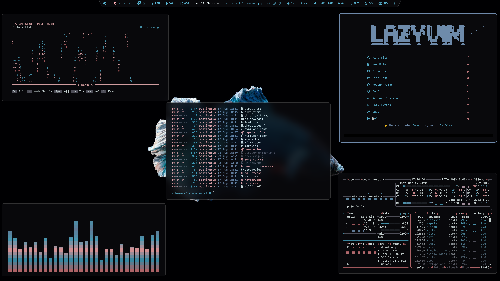
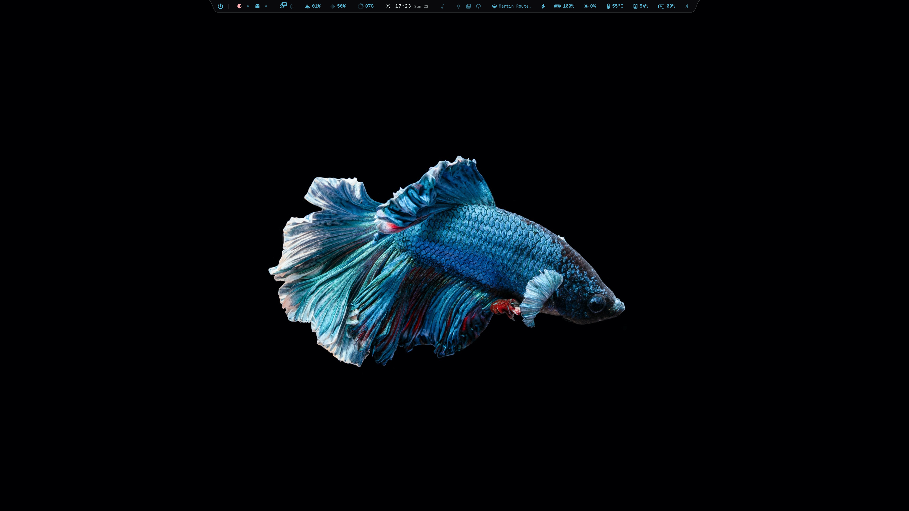
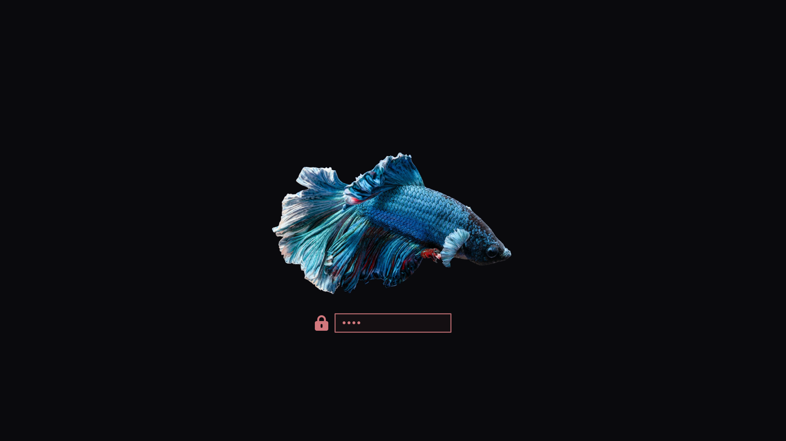

# Fish Material Theme for Omarchy

> *"The sea, once it casts its spell, holds one in its net of wonder forever."*
> Jacques Cousteau



## The Story

Fish Material was born from the quiet of deep water at night. Down there everything is dark and still, an abyss that is almost pure black, and then a flash of coral cuts through it like a fish passing by. That contrast became this theme: a near-black canvas, an icy foam-white foreground, and a muted coral accent that glows without ever shouting.

The palette follows the restraint of Material Design: few hues, honest grays, and one warm accent doing all the work. Steel blue keeps things cool and focused, while soft salmon highlights add warmth where it matters.

This is my tribute to that feeling of diving into something deep and calm.

---



## Colors

The palette is built around deep water and coral life: abyss black backgrounds, foam white text, and a muted coral accent that feels alive against the dark.

| Role | Color | Hex |
|------|-------|-----|
| Background | Abyss |  `#0a0a0d` |
| Foreground | Sea Foam |  `#f2ffff` |
| Accent | Coral |  `#d2787d` |
| Border (active) | Steel Blue |  `#7694b7` |
| Highlight | Salmon Pink |  `#ffb0b5` |
| Lagoon | Cyan Tide |  `#5ab7d5` |

## Features

- **Steel blue focus**: active windows get a calm steel-blue border, inactive ones fade into gray
- **Translucency & blur**: subtle window opacity with vibrancy boosted blur and rounded corners
- **SwayOSD glow**: volume bar flows in soft salmon pink
- **Yaru-blue icons**: icon set tuned to match the cold water mood
- **Full theme coverage**: Hyprland, Waybar, Kitty, Ghostty, Foot, Alacritty, Neovim, Zed, VS Code (applied automatically with the theme), GTK, btop, Mako, Wofi, Walker, Hyprlock, Zellij, cava, Warp

## Lock Screen



## Installation

```bash
omarchy-theme-install https://github.com/Eidan78/omarchy-fish-material-theme
```

Then select **fish-material** from the Omarchy theme menu (`Super + Ctrl + Shift + Space`).

---

*Built with love for the Omarchy community using the amazing Aether as starting point.*
